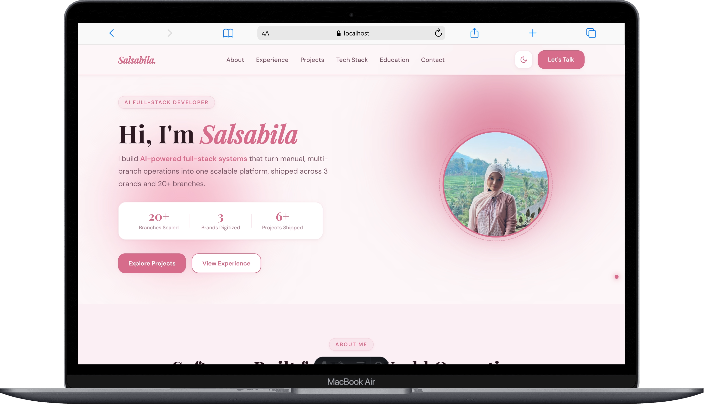

# Salsabila | Portfolio

Personal portfolio of **Salsabila**, an AI Full-Stack Developer based in Bandung, Indonesia. It showcases my experience, projects, and tech stack in a fast, responsive, and accessible static site.

**Live site:** [salsabila.dev](https://salsabila.dev)



## About

I build full-stack products and integrate applied AI directly into web apps. This portfolio presents the work behind that: a multi-brand warehouse management system, AI-powered assistants, computer vision, and more, each with the problem it solves and the result it delivered.

## Sections

- **Hero:** introduction, value proposition, and key stats
- **About:** background, focus, current role, and availability
- **Experience:** internship, cohort, writing, and community work
- **Projects:** featured work, each told as problem, solution, and impact
- **Tech Stack:** tools grouped by web, backend, and applied AI
- **Education:** academic background at Universitas Komputer Indonesia
- **Contact:** email, GitHub, and LinkedIn

## Features

- Responsive layout for desktop, tablet, and mobile
- Light and dark mode toggle
- Draggable, auto-scrolling tech stack marquee
- Project cards with image sliders and direct links
- SEO-ready: meta tags, Open Graph, sitemap, and structured data
- Minimal client-side JavaScript for fast load times

## Tech Stack

| Layer | Technologies |
|---|---|
| Framework | Astro |
| Styling | Tailwind CSS |
| Deployment | Vercel |

## Getting Started

### Prerequisites

- Node.js 20+
- npm

### Installation

```bash
git clone https://github.com/salsabl22/my-portfolio.git
cd my-portfolio
npm install
```

### Development

```bash
npm run dev
```

Open `http://localhost:4321` in your browser.

### Build for production

```bash
npm run build
npm run preview
```

## Project Structure

```
portfolio/
├── public/          # Static assets (favicon, og-image, icons, robots.txt)
├── src/
│   ├── components/  # Reusable UI components
│   ├── layouts/     # Page layouts and SEO head
│   ├── pages/       # Site pages
│   └── styles/      # Global styles
├── astro.config.mjs
├── tailwind.config.mjs
└── package.json
```

## Contact

- **Email:** salsabila.codes@gmail.com
- **LinkedIn:** [linkedin.com/in/salsabilatech](https://linkedin.com/in/salsabilatech)
- **GitHub:** [github.com/salsabl22](https://github.com/salsabl22)

## License

© 2026 Salsabila. All rights reserved.
The source is shared for reference. Please do not copy the content or design as your own.
